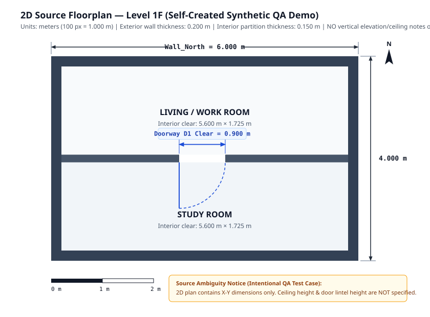
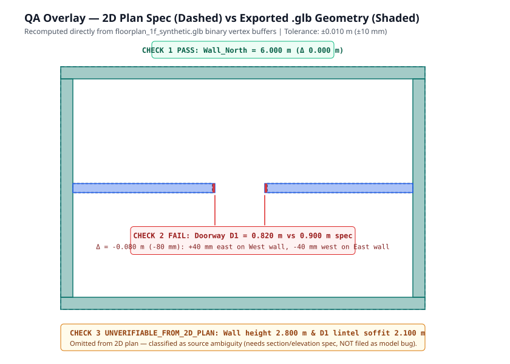

# Synthetic 2D Floorplan vs 3D GLB Model QA Report (Self-Created Demo)

> **Disclosure**: This is a **self-created synthetic QA demonstration** authored by **NovaCraft Studio** (human-led by Fan Zhu, using an AI-assisted deterministic verification workflow). It is **not** client work and does **not** use proprietary drawings. Every artifact (`floorplan_1f_synthetic.svg`, `floorplan_1f_synthetic.glb`, `verify_floorplan_glb_qa.py`, `test_floorplan_glb_qa.py`) is committed here so any reviewer can independently re-measure every vertex and reproduce all findings.

## 1. Visual Comparison (Source 2D Plan vs Exported `.glb` Footprints)

**2D Source Floorplan (`floorplan_1f_synthetic.svg`)**



**QA Overlay Recomputed from `.glb` Vertex Buffers (`plan_vs_model_overlay.svg`)**



## 2. Executive QA Summary (`tolerance = ±0.010 m / ±10 mm`)

| Check ID | Item Checked | 2D Plan Spec | Exported `.glb` Measured | Delta | Verdict | Classification |
| :--- | :--- | ---: | ---: | ---: | :---: | :--- |
| **CHK-01** | Exterior North Wall Overall Length (`Wall_North`) | `6.000 m` | `6.000 m` | `0.000 m` | **PASS** | Faithful geometry; also verifies global `1 unit = 1 m` scale |
| **CHK-02** | Interior Doorway `D1` Clear Opening Width (`Wall_Partition_West` → `Wall_Partition_East`) | `0.900 m` (`x ∈ [2.500, 3.400]`) | `0.820 m` (`x ∈ [2.540, 3.360]`) | **`-0.080 m` (`-80 mm`)** | **FAIL** | **Source-to-model geometry defect** (seeded QA fault) |
| **CHK-03** | Ceiling / Wall Extrusion Height (`2.800 m`) & Door `D1` Lintel Soffit (`2.100 m`) | *Not specified on 2D plan* | `2.800 m` / `2.100 m` (assumed in `.glb`) | *N/A* | **UNVERIFIABLE FROM 2D PLAN** | **Source drawing ambiguity** (must not be guessed or filed as model bug) |

## 3. Defect Ticket Detail (`CHK-02`) — Reproducible Source-to-Model Mismatch

- **Drawing Reference**: `floorplan_1f_synthetic.svg`, Level 1F interior partition wall (`z = 1.925..2.075 m`), callout `Doorway D1 Clear = 0.900 m` (`x = 2.500 m` to `3.400 m`).
- **Expected Behavior**: Clear horizontal opening between `Wall_Partition_West` (`max_x`) and `Wall_Partition_East` (`min_x`) equals `0.900 m ± 0.010 m`.
- **Actual Behavior**: Raw binary vertex buffer inspection of `floorplan_1f_synthetic.glb` measures:
  - `Wall_Partition_West` `max_x = 2.540 m` (`+40 mm` encroachment east into opening),
  - `Wall_Partition_East` `min_x = 3.360 m` (`-40 mm` encroachment west into opening),
  - Net clear opening = `3.360 - 2.540 = 0.820 m` (`-80 mm` narrower than plan).
- **Rule-Out Check (Hidden Wall / Unit Scale / Display Setting)**:
  - Verified all `8` named nodes in `floorplan_1f_synthetic.glb` carry `scale = [1.0, 1.0, 1.0]` and identity rotation `[0, 0, 0, 1]`.
  - Verified `Floor_Slab` (`6.000 m × 4.000 m`) and `Wall_North` (`6.000 m`) match the 2D plan exactly — ruling out a global unit-scale error (e.g., feet/inches or percentage shrink).
  - Verified **zero** hidden, duplicated, or overlapping jamb meshes exist inside the doorway corridor (`x ∈ (2.540, 3.360)`, `y ∈ (0.000, 2.000)`, `z ∈ (1.925, 2.075)`) — ruling out a hidden wall or viewer culling/display artifact.
- **User / Downstream Impact**: A model that looks visually plausible in 3D silently narrows an interior doorway by `80 mm`, breaking furniture-fit checks (`0.85 m` desk/appliance clearance) and standard `0.90 m` door frame procurement.

## 4. Source Ambiguity Separation (`CHK-03`)

- The exported `.glb` sets all walls to `y = 0.000..2.800 m` and `Door_D1_Lintel` soffit to `y = 2.100 m`, but `floorplan_1f_synthetic.svg` is a 2D plan containing X-Y dimensions only.
- Rather than guessing a default ceiling height or raising a false defect ticket, `CHK-03` is explicitly logged as **`UNVERIFIABLE_FROM_2D_PLAN`** pending a section/elevation drawing or written spec from the author.

## 5. Independent Recomputation (Zero Dependencies, Python 3)

Any reviewer can clone this directory and re-run the binary `.glb` parser and unit tests in under 1 second:

```bash
python3 verify_floorplan_glb_qa.py
python3 -m unittest -v test_floorplan_glb_qa.py
```

Machine-readable output is written to [`qa_verification_result.json`](./qa_verification_result.json).
