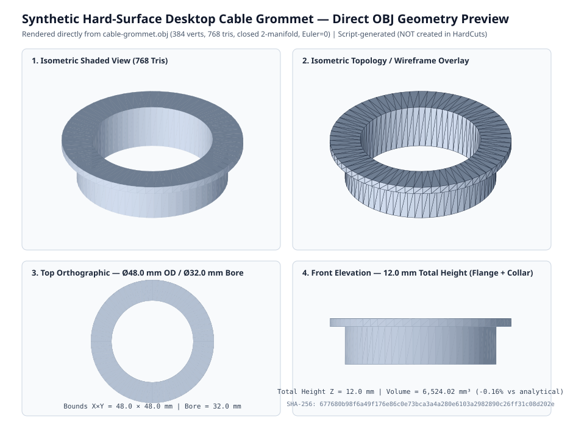

# Synthetic Hard-Surface Desktop Cable Grommet — Geometry & Topology Sample

> **Provenance Disclosure**: This is an **original, procedurally script-generated hard-surface geometry sample** prepared by **NovaCraft Studio** (human-led by Fan Zhu, using an AI-assisted workflow). It was **not** modeled or recorded inside HardCuts and does not use third-party or client assets.

## Direct Multi-View Geometry Preview (Rendered from `cable-grommet.obj`)

## Independently Verified Mesh Metrics (`cable-grommet-verification.json`)

| Property | Measured Value |
| :--- | :--- |
| Model | Synthetic desktop cable grommet (flanged collar + beveled rim) |
| Bounding Box (`X × Y × Z`) | `48.0 mm × 48.0 mm × 12.0 mm` |
| Inner Bore Diameter | `32.0 mm` |
| Vertices / Triangles | `384` vertices / `768` triangles |
| Manifold Integrity | Closed 2-manifold (`edge_incidence_values: [2]`, Euler characteristic `0`) |
| Mesh Volume vs Analytical | `6,524.021 mm³` vs `6,534.513 mm³` (`-0.1606%` discretization delta) |
| OBJ SHA-256 | `677680b98f6a49f176e86c0e73bca3a4a280e6103a2982890c26ff31c08d202e` |

## Files Included

- [`cable-grommet.obj`](./cable-grommet.obj) — ASCII Wavefront OBJ mesh (`22,486` bytes, metric `mm`).
- [`cable-grommet-verification.json`](./cable-grommet-verification.json) — Independent geometric verification summary.
- [`cable_grommet_multiview_preview.svg`](./cable_grommet_multiview_preview.svg) — Shaded isometric, wireframe topology, top orthographic, and front profile views rendered directly from `cable-grommet.obj`.
